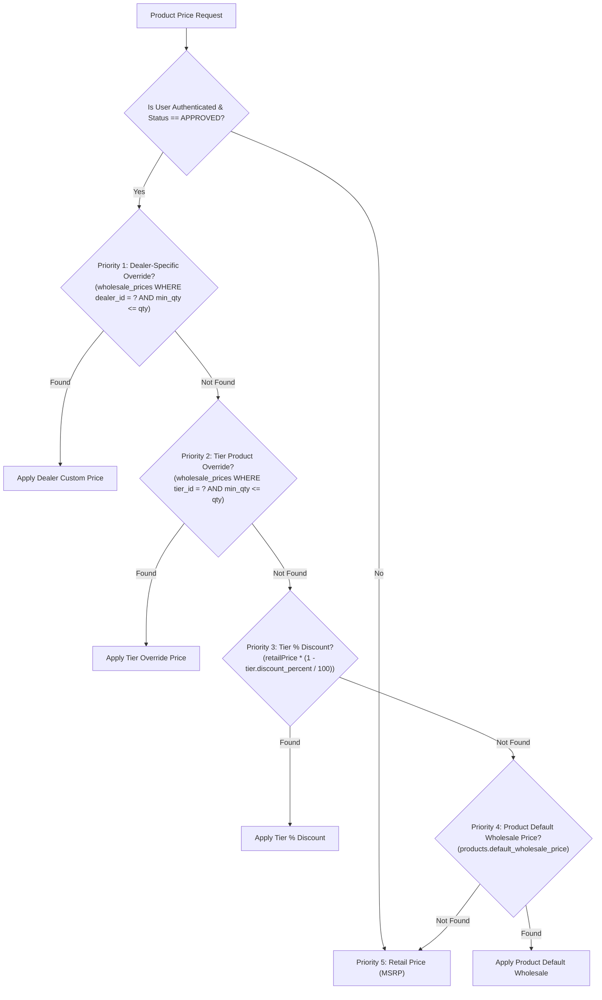

# Wall Street Interiors — B2B Dealer & Wholesale Portal Architecture

This document provides a comprehensive operational guide and architectural specification for the B2B Dealer / Wholesale Portal implemented within the Wall Street Interiors Next.js 15 e-commerce platform.

---

## 1. Executive Summary & Security Guardrails

The B2B Dealer Portal provides approved commercial partners (retailers, fit-out contractors, interior designers, and bulk buyers) in Kashmir with importer-direct wholesale pricing, tiered volume rates, credit terms, multi-destination godown shipping, and GST tax invoice generation.

### Absolute Security Invariant: Non-Leakage of Wholesale Prices
Wholesale rates and distributor margins are **strictly classified business assets**. The platform guarantees:
- **Zero Public Exposure**: Ordinary visitors, unapproved accounts, and search engines (`Googlebot`, etc.) never receive wholesale pricing in HTML, Next.js RSC payloads, API responses, JSON-LD, sitemaps, Open Graph metadata, or static page caches.
- **Server-Side Authorization**: Every price is calculated server-side in `src/lib/b2b/pricing.ts` using fresh database session verification (`src/lib/auth.ts`).
- **No Client Tampering**: Cart repricing and order creation (`createOrderAction`) validate prices and Minimum Order Quantities (MOQ) on the server.

---

## 2. Database Schema & Migration Architecture

All database changes are **additive and backward-compatible**, executed without downtime via `scripts/migrate-b2b-schema.ts`.

### Tables Created:
1. `dealer_tiers`: Defines global discount tiers (Gold, Silver, Bronze) with `discount_percent` and threshold details.
2. `dealer_profiles`: Stores business registration, GSTIN, business type, verification status (`PENDING`, `APPROVED`, `REJECTED`, `SUSPENDED`), assigned tier, credit limits, and credit payment days (e.g. Net 30).
3. `wholesale_prices`: Stores per-product default wholesale rates, tier-specific overrides, and dealer-specific contract pricing with quantity breaks (`min_quantity`).
4. `dealer_addresses`: Multi-destination address book for site deliveries, godowns, and project warehouses.
5. `b2b_audit_logs`: Immutable audit trail tracking dealer status transitions, credit changes, and admin approvals.

### Alterations:
- `orders`: Added `is_b2b` (TINYINT), `dealer_id` (INT), `invoice_terms` (VARCHAR), `purchase_order_number` (VARCHAR).
- `products`: Added `default_wholesale_price` (DECIMAL 10,2) and `min_order_quantity` (INT).

---

## 3. Pricing Resolution Hierarchy

When an item is priced for an authenticated dealer, `calculateWholesalePrice()` applies the following strict priority:



---

## 4. Dealer Lifecycle & Workflows

1. **Registration (`/dealer/register`)**:
   - Applicant submits Business Name, GST/Tax ID, Contact Person, Phone, Email, Business Type, and Street Address.
   - Status initialized to `PENDING`.
   - Automated confirmation email sent; session redirected to `/dealer/pending`.
2. **Admin Review (`/dashboard/dealers`)**:
   - Administrator reviews GSTIN, verifies trade credentials, assigns a tier (e.g., Gold, Silver), and configures credit terms (e.g., Net 30, ₹5,00,000 credit line).
   - Approval triggers automated congratulatory email with direct login link.
3. **Purchasing (`/dealer` & `/shop`)**:
   - Approved dealer accesses the portal dashboard showing spend metrics, assigned tier discount, and credit terms.
   - Orders placed can select standard payment methods or "Pay on Invoice / Credit Terms" if authorized.
4. **Order Tracking & Tax Invoices (`/dealer/orders`, `/dealer/orders/[id]`)**:
   - Shows order timeline, PO numbers, and dedicated printable B2B Tax Invoices with GSTIN compliance.
   - Protected with strict IDOR controls (`WHERE id = ? AND dealer_id = ?`).

---

## 5. Seed Accounts for Testing & Development

Run `npx tsx scripts/seed-b2b.ts` to populate test accounts:

| Role / Account Type | Email | Password | Tier | Status | Credit Terms |
| :--- | :--- | :--- | :--- | :--- | :--- |
| **Approved Dealer (Gold)** | `approved_dealer@wallstreet.com` | `dealer123` | Gold (20%) | `APPROVED` | Net 30 (₹5,00,000) |
| **Approved Dealer (Silver)**| `silver_dealer@wallstreet.com` | `dealer123` | Silver (15%) | `APPROVED` | Net 15 (₹2,50,000) |
| **Pending Dealer** | `pending_dealer@wallstreet.com` | `dealer123` | Bronze (10%) | `PENDING` | None |
| **Suspended Dealer** | `suspended_dealer@wallstreet.com` | `dealer123` | Bronze (10%) | `SUSPENDED` | None |
| **Admin** | `admin@wallstreet.com` | *[Existing]* | N/A | Admin | Full Access |

---

## 6. Verification & Automated Test Suites

Run the standalone verification suite:
```bash
npx tsx scripts/test-b2b-pricing.ts
```
Expected output:
- Unauthenticated / Ordinary visitor receives MSRP (0% wholesale leak).
- Pending dealer is denied wholesale pricing.
- Approved dealer resolves tier percentage discounts.
- Dealer-specific override overrides tier discount (Priority 1 enforcement).
